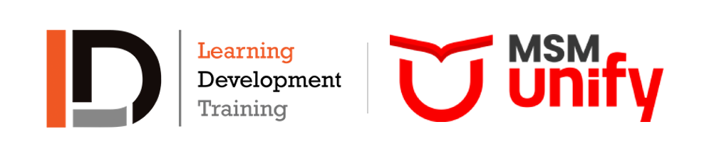

# LDI Online Pathway landing page

Co-branded landing page for LD International (LDI) with application support from MSM Unify. Static HTML, no dependencies.

- Live review site: https://ldi-uk-pathway.vercel.app
- GitHub Pages copy: https://nikhilsharda.github.io/ldi-uk-pathway-landing/

## Files
- `index.html` - the page as shown on the live site, with images and both logos embedded, so it renders identically anywhere (download it, open it, host it).
- `index.src.html` - the same page with images loaded from `img/` (edit this one, then run `python3 build.py`).
- `img/` - hero and section photography (AI-generated), the LD Training and MSM Unify logos, and the co-brand lockup.
- `build.py` - regenerates `index.html` from `index.src.html` and fails if an em or en dash is present.
- `vercel.json`, `robots.txt` - noindex settings used while the page is in review. Remove them when the page goes live for search.

## Connect lead capture to Zoho CRM
Edit the `CONFIG` block at the bottom of `index.src.html`:
- `ZOHO_ACTION`, `ZOHO_XNQSJSDP`, `ZOHO_XMIWTLD` come from a Zoho Web-to-Lead form. Do not commit them to a public repo.
- Leave them blank to run in preview mode (nothing is sent).

Market links: `?m=india|pakistan|srilanka|uae|nigeria|ghana|nepal` swaps the hero line and pre-fills country and dial code. UTM parameters are captured into the lead description.

## Notes
- Logos belong to their owners. LD Training's brand guidelines require written consent for logo use.
- Copy rules: UK English, no em dashes, and progression to a UK university is always described as "potential" and conditional.
